# База данных DuckDB

Файл: `data/armstat_trade.duckdb` (собирается командой `make build`; полностью пересоздаётся из
`data/raw` и `data/catalog` при каждом запуске). Подробный перечень колонок — [data_dictionary.md](data_dictionary.md)
(генерируется из комментариев `COMMENT ON`, которые хранятся и в самой БД).

## Принципы проектирования

1. **Слои.** Метаданные о происхождении (`meta_*`) → справочники (`dim_*`) → факты из веб-БД (`db_*`)
   и из файлов (`file_*`) → промежуточные копии выгрузок на всех языках (`stg_*`) → ячейки xlsx без потерь
   (`raw_*`) → проверки качества (`qc_*`) → представления (`v_*`).
2. **Без потерь.** Всё содержимое источников попадает в БД: каждая ячейка каждого xlsx (`raw_xlsx_cell`),
   каждая строка каждой выгрузки веб-БД на каждом языке (`stg_db_*`). Структурированные таблицы
   хранят `workbook_id` + `row_num`, по которым можно найти исходную ячейку.
3. **Многоязычность в справочниках.** Факты не зависят от языка; названия на `en`/`hy`/`ru` хранятся
   в справочниках (`dim_country`, `dim_hs`, `dim_hs_section`, `dim_flow`, …). Все встреченные варианты
   написания названий стран — в `dim_country_name`.
4. **Длинный формат по потоку, широкий по показателям.** Строка факта = (ключи, `flow`); показатели — колонки
   с единицей измерения в имени: `weight_ton`, `quantity`, `value_usd`, `value_kusd` (тыс. $),
   `value_musd` (млн $), `value_mln_amd` (млн драмов), `share_pct`. Значения хранятся в единицах источника,
   без пересчёта.
5. **Редакции.** Файлы — это публикации; один и тот же год встречается в нескольких файлах (ранние
   редакции, многолетние листы бюллетеней). Ключ `workbook_id` + флаг `meta_workbook.is_current`;
   представления `v_*_current` берут только текущие редакции, `v_*_latest` — самую позднюю публикацию
   для каждого года.
6. **Коды.** Коды ТН ВЭД — строки с ведущими нулями (`'0101'`, `'0101210000'`), коды стран — целые
   (ISO 3166-1 numeric + специальные 997 физлица, 998 неизвестная страна, 999 Нагорный Карабах,
   1111 страны ЕС не указанные). Строки итогов в фактах помечены `row_type` (`total`, `chapter`, …)
   — при суммировании фильтруйте по `row_type`.
7. **Воспроизводимость.** Схема — `sql/schema.sql`, представления — `sql/views.sql`, проверки —
   `sql/qc.sql`; сборка атомарная (пишется во временный файл и заменяет готовую БД в конце).

## Схема

```mermaid
erDiagram
    meta_page }o--|| meta_language : lang
    meta_file ||--o{ meta_workbook : file_id
    meta_workbook ||--o{ meta_sheet : workbook_id
    meta_workbook ||--o{ raw_xlsx_cell : workbook_id
    meta_db_query ||..o{ stg_db_country : "nid, lang, mode, year"
    meta_db_query ||..o{ stg_db_commodity : "lang, mode, year"

    dim_country ||--o{ db_country_trade : country_code
    dim_flow ||--o{ db_country_trade : flow
    dim_hs ||--o{ db_commodity_trade : hs4_code

    meta_workbook ||--o{ file_hs4_trade : workbook_id
    meta_workbook ||--o{ file_hs10_trade : workbook_id
    meta_workbook ||--o{ file_hs10_aggregate : workbook_id
    meta_workbook ||--o{ file_country_trade : workbook_id
    meta_workbook ||--o{ file_sitc_trade : workbook_id
    meta_workbook ||--o{ file_bec_trade : workbook_id
    meta_workbook ||--o{ file_hs2_trade : workbook_id
    meta_workbook ||--o{ file_hs2_partner_trade : workbook_id
    meta_workbook ||--o{ file_hs2_country_trade : workbook_id
    meta_workbook ||--o{ file_humanitarian_aid : workbook_id

    dim_hs ||--o{ file_hs4_trade : hs4_code
    dim_data_basis ||--o{ file_hs4_trade : basis
    dim_hs ||--o{ file_hs10_trade : hs10_code
    dim_unit ||--o{ file_hs10_trade : unit_code
    dim_hs_section ||--o{ dim_hs : section
    dim_country ||--o{ file_country_trade : country_code
    dim_country_group ||--o{ file_country_trade : group_code
    dim_sitc ||--o{ file_sitc_trade : sitc_code
    dim_bec ||--o{ file_bec_trade : bec_code
    dim_hs ||--o{ file_hs2_trade : hs_code
    dim_country ||--o{ file_hs2_partner_trade : country_code
    dim_country_group ||--o{ file_hs2_partner_trade : group_code
    dim_hs ||--o{ file_hs2_partner_trade : hs2_code
    dim_country ||--o{ file_hs2_country_trade : country_code
    dim_country ||--o{ file_humanitarian_aid : country_code
```



## Таблицы

### Метаданные

| таблица | строка = | ключ |
|---|---|---|
| `meta_language` | язык сайта | `lang` |
| `meta_page` | страница раздела × язык | `nid, lang` |
| `meta_file` | файл по ссылке | `file_id` |
| `meta_workbook` | книга xlsx (файл или член архива) | `workbook_id` |
| `meta_sheet` | лист книги, его тип и целевая таблица | `workbook_id, sheet` |
| `meta_db_query` | запрос к веб-БД (страница × язык × режим × год) | `nid, lang, mode, year` |

### Справочники

| таблица | содержание | источники названий |
|---|---|---|
| `dim_country` | страны-партнёры, alpha-2, названия en/hy/ru | форма веб-БД (3 языка), листы `Countries` (alpha-2) |
| `dim_country_name` | все варианты написаний | все источники |
| `dim_country_group` | группы стран бюллетеней | справочник `reference.py` |
| `dim_hs` | коды ТН ВЭД 2/4/10 знаков, иерархия (`parent_code`, `section`) | 4 знака — форма веб-БД (en/hy/ru) и выгрузки; 2 знака — файлы (hy/en) и ТН ВЭД 2017 (ru); 10 знаков — только коды |
| `dim_hs_section` | разделы I–XXI | файлы (hy/en), ТН ВЭД 2017 (ru) |
| `dim_sitc` | разделы и подразделы МСТК | бюллетени (hy/en) |
| `dim_bec` | категории BEC | бюллетени (hy/en), код — по английскому названию |
| `dim_unit` | дополнительные единицы измерения | 10-значные файлы |
| `dim_flow`, `dim_measure`, `dim_data_basis` | потоки, показатели, основа данных | `reference.py` |

### Факты

| таблица | источник | зерно (строка =) | показатели | годы |
|---|---|---|---|---|
| `db_country_trade` | веб-БД 159/717 | страна × год × месяц(NULL = год) × поток | `value_kusd` | 1995–2026 (мес. с 2003) |
| `db_commodity_trade` | веб-БД 148 | позиция HS4 × год × месяц × поток | `weight_ton`, `value_kusd` | 1995–2026 (мес. с 2007) |
| `file_hs4_trade` | файлы 777 | редакция × основа × позиция HS4 × поток | `weight_ton`, `value_kusd` | 2018–2025 |
| `file_hs10_trade` | файлы 778 | редакция × код HS10 × поток | `quantity`, `weight_ton`, `value_usd` | 2018–2025 |
| `file_hs10_aggregate` | файлы 778 | строка-итог (раздел/группа/позиция) × поток | `weight_ton`, `value_usd` | 2018–2025 |
| `file_country_trade` | бюллетени 766, `Countries` | бюллетень × страна/группа × год × поток | `value_kusd` | 2015–2024 |
| `file_sitc_trade` | бюллетени, `SITC-1/2` | бюллетень × код SITC × год × поток | `weight_ton`, `value_kusd` | 2015–2024 |
| `file_bec_trade` | бюллетени, `BEC-1` | бюллетень × BEC × год × поток | `value_musd` | 2015–2024 |
| `file_hs2_trade` | бюллетени, `By_Groups`, `Groups_%` | бюллетень × группа/раздел × год × поток | `value_kusd`, `share_pct` | 2015–2024 |
| `file_hs2_partner_trade` | бюллетени, листы групп/стран | бюллетень × партнёр (группа или страна) × группа HS2 × поток | `weight_ton`, `value_mln_amd`, `value_kusd` | 2018–2024 |
| `file_hs2_country_trade` | бюллетени, `by Commodity Groups` | бюллетень × группа HS2 × страна × поток | `weight_ton`, `value_kusd` | 2018–2024 |
| `file_humanitarian_aid` | бюллетени, `Hum-Aid` | бюллетень × группа HS2 × страна-донор | `weight_ton`, `value_usd` | 2018–2024 |

### Промежуточные и сырые данные

| таблица | содержание |
|---|---|
| `stg_db_country` | все строки выгрузок по странам: страницы 159 и 717 × 3 языка × годовые/месячные, с исходным названием страны и найденным кодом |
| `stg_db_commodity` | все строки выгрузок по товарам × 3 языка |
| `raw_xlsx_cell` | все непустые ячейки всех книг |

### Представления

| представление | назначение |
|---|---|
| `v_db_country_annual`, `v_db_country_monthly` | веб-БД по странам, широкий формат (экспорт / импорт по происхождению / по отправлению) с названиями |
| `v_db_commodity_annual`, `v_db_commodity_monthly` | веб-БД по товарам, широкий формат с названиями |
| `v_file_hs10_current` | 10-значные данные, только текущие редакции, без приложения «Transport total» |
| `v_file_hs4_current` | 4-значные данные текущих редакций |
| `v_file_hs2_partner_current` | группы HS2 × партнёр текущих бюллетеней с названиями |
| `v_file_country_trade_latest`, `v_file_hs2_trade_latest`, `v_file_sitc_trade_latest`, `v_file_bec_trade_latest` | многолетние листы бюллетеней: для каждого года — самая поздняя публикация |
| `v_sources` | перечень всех файлов и запросов |

### Проверки качества

`qc_summary` — сводка; детальные таблицы: `qc_db_country_overlap`, `qc_db_language_consistency`,
`qc_db_monthly_vs_annual`, `qc_file_totals`, `qc_file_vs_db_hs4`, `qc_unresolved_country`.
Результаты и известные проблемы источников — [data_quality.md](data_quality.md).

## Примеры запросов

Больше примеров — с графиками, сравнением источников и ревизий — в тетрадке [examples.ipynb](examples.ipynb).

```sql
-- Топ-10 стран по экспорту в 2025 г. (веб-БД, тыс. $)
SELECT name_ru, export_kusd
FROM v_db_country_annual WHERE year = 2025
ORDER BY export_kusd DESC LIMIT 10;

-- Помесячный экспорт и импорт (по стране происхождения) в целом по стране
SELECT period_start, sum(export_kusd) AS export, sum(import_origin_kusd) AS import
FROM v_db_country_monthly GROUP BY ALL ORDER BY period_start;

-- Экспорт коньяка/бренди (позиция 2208) по годам, т и тыс. $
SELECT year, export_ton, export_kusd FROM v_db_commodity_annual WHERE hs4_code = '2208' ORDER BY year;

-- 10-значные коды позиции 7108 (золото) в 2025 г.
SELECT hs10_code, flow, quantity, unit_code, weight_ton, value_usd
FROM v_file_hs10_current WHERE year = 2025 AND hs4_code = '7108';

-- Структура экспорта в ЕС по группам ТН ВЭД (бюллетень 2024)
SELECT hs2_code, hs2_name_ru, value_kusd
FROM v_file_hs2_partner_current
WHERE year = 2024 AND group_code = 'EU' AND flow = 'export'
ORDER BY value_kusd DESC NULLS LAST;

-- Как менялись данные за 2021 г. в разных бюллетенях (ревизии)
SELECT w.year AS bulletin, t.value_kusd
FROM file_country_trade t JOIN meta_workbook w USING (workbook_id)
WHERE t.year = 2021 AND t.group_code = 'WORLD' AND t.row_type = 'group' AND t.flow = 'export'
ORDER BY bulletin;

-- Найти исходную ячейку значения
SELECT * FROM raw_xlsx_cell WHERE workbook_id = '99563478' AND sheet = 'Sheet1' AND row_num = 7;
```
