# DuckDB database

**English** | [Հայերեն](../hy/database.md) | [Русский](../ru/database.md)

File: `data/armstat_trade.duckdb` (built with `make build`; recreated from scratch from `data/raw` and
`data/catalog` on every run). The full list of columns is in [data_dictionary.md](../data_dictionary.md)
(generated from the `COMMENT ON` descriptions, which are also stored in the database itself).

## Design principles

1. **Layers.** Provenance metadata (`meta_*`) → reference tables (`dim_*`) → facts from the web database (`db_*`)
   and from the files (`file_*`) → staging copies of the exports in all languages (`stg_*`) → lossless xlsx cells
   (`raw_*`) → data quality checks (`qc_*`) → views (`v_*`).
2. **Lossless.** All source content goes into the database: every cell of every xlsx (`raw_xlsx_cell`),
   every row of every web database export in every language (`stg_db_*`). Structured tables keep
   `workbook_id` + `row_num`, which lead back to the source cell.
3. **Languages live in reference tables.** Facts do not depend on the language; names in `en`/`hy`/`ru` are stored
   in the reference tables (`dim_country`, `dim_hs`, `dim_hs_section`, `dim_flow`, …). All spellings of country
   names that were encountered are in `dim_country_name`.
4. **Long by flow, wide by measure.** A fact row = (keys, `flow`); measures are columns with the unit in the name:
   `weight_ton`, `quantity`, `value_usd`, `value_kusd` (thousand USD), `value_musd` (million USD),
   `value_mln_amd` (million AMD), `share_pct`. Values are stored in the units of the source, without conversion.
5. **Editions.** Files are publications; the same year appears in several files (early editions, multi-year
   bulletin sheets). The key is `workbook_id` + the flag `meta_workbook.is_current`; the `v_*_current` views take
   only current editions, the `v_*_latest` views take the latest publication for each year.
6. **Codes.** CN FEA codes are strings with leading zeros (`'0101'`, `'0101210000'`); country codes are integers
   (ISO 3166-1 numeric + special codes 997 physical persons, 998 unknown country, 999 Nagorno-Karabakh,
   1111 EU countries not specified). Total rows in fact tables are marked with `row_type` (`total`, `chapter`, …)
   — filter by `row_type` when summing.
7. **Reproducibility.** Schema — `sql/schema.sql`, views — `sql/views.sql`, checks — `sql/qc.sql`; the build is
   atomic (it writes to a temporary file and replaces the finished database at the end).

## Schema

```mermaid
erDiagram
    meta_page }o--|| meta_language : lang
    meta_file ||--o{ meta_workbook : file_id
    meta_workbook ||--o{ meta_sheet : workbook_id
    meta_workbook ||--o{ raw_xlsx_cell : workbook_id
    meta_db_query ||..o{ stg_db_country : "nid, lang, mode, year"
    meta_db_query ||..o{ stg_db_commodity : "lang, mode, year"

    dim_country ||--o{ db_country_trade : country_code
    dim_flow ||--o{ db_country_trade : flow
    dim_hs ||--o{ db_commodity_trade : hs4_code

    meta_workbook ||--o{ file_hs4_trade : workbook_id
    meta_workbook ||--o{ file_hs10_trade : workbook_id
    meta_workbook ||--o{ file_hs10_aggregate : workbook_id
    meta_workbook ||--o{ file_country_trade : workbook_id
    meta_workbook ||--o{ file_sitc_trade : workbook_id
    meta_workbook ||--o{ file_bec_trade : workbook_id
    meta_workbook ||--o{ file_hs2_trade : workbook_id
    meta_workbook ||--o{ file_hs2_partner_trade : workbook_id
    meta_workbook ||--o{ file_hs2_country_trade : workbook_id
    meta_workbook ||--o{ file_humanitarian_aid : workbook_id

    dim_hs ||--o{ file_hs4_trade : hs4_code
    dim_data_basis ||--o{ file_hs4_trade : basis
    dim_hs ||--o{ file_hs10_trade : hs10_code
    dim_unit ||--o{ file_hs10_trade : unit_code
    dim_hs_section ||--o{ dim_hs : section
    dim_country ||--o{ file_country_trade : country_code
    dim_country_group ||--o{ file_country_trade : group_code
    dim_sitc ||--o{ file_sitc_trade : sitc_code
    dim_bec ||--o{ file_bec_trade : bec_code
    dim_hs ||--o{ file_hs2_trade : hs_code
    dim_country ||--o{ file_hs2_partner_trade : country_code
    dim_country_group ||--o{ file_hs2_partner_trade : group_code
    dim_hs ||--o{ file_hs2_partner_trade : hs2_code
    dim_country ||--o{ file_hs2_country_trade : country_code
    dim_country ||--o{ file_humanitarian_aid : country_code
```



## Tables

### Metadata

| table | one row = | key |
|---|---|---|
| `meta_language` | website language | `lang` |
| `meta_page` | section page × language | `nid, lang` |
| `meta_file` | linked file | `file_id` |
| `meta_workbook` | xlsx workbook (a file or an archive member) | `workbook_id` |
| `meta_sheet` | workbook sheet, its type and target table | `workbook_id, sheet` |
| `meta_db_query` | web database request (page × language × mode × year) | `nid, lang, mode, year` |

### Reference tables

| table | contents | sources of names |
|---|---|---|
| `dim_country` | partner countries, alpha-2, names en/hy/ru | web database form (3 languages), `Countries` sheets (alpha-2) |
| `dim_country_name` | all spellings | all sources |
| `dim_country_group` | country groups of the bulletins | `reference.py` |
| `dim_hs` | CN FEA codes of 2/4/10 digits, hierarchy (`parent_code`, `section`) | 4 digits — web database form (en/hy/ru) and exports; 2 digits — files (hy/en) and CN FEA 2017 (ru); 10 digits — codes only |
| `dim_hs_section` | sections I–XXI | files (hy/en), CN FEA 2017 (ru) |
| `dim_sitc` | SITC sections and divisions | bulletins (hy/en) |
| `dim_bec` | BEC categories | bulletins (hy/en), code assigned by the English name |
| `dim_unit` | supplementary units of measurement | 10-digit files |
| `dim_flow`, `dim_measure`, `dim_data_basis` | flows, measures, data basis | `reference.py` |

### Facts

| table | source | grain (one row =) | measures | years |
|---|---|---|---|---|
| `db_country_trade` | web database 159/717 | country × year × month (NULL = year) × flow | `value_kusd` | 1995–2026 (monthly since 2003) |
| `db_commodity_trade` | web database 148 | HS4 heading × year × month × flow | `weight_ton`, `value_kusd` | 1995–2026 (monthly since 2007) |
| `file_hs4_trade` | files 777 | edition × basis × HS4 heading × flow | `weight_ton`, `value_kusd` | 2018–2025 |
| `file_hs10_trade` | files 778 | edition × HS10 code × flow | `quantity`, `weight_ton`, `value_usd` | 2018–2025 |
| `file_hs10_aggregate` | files 778 | total row (section/chapter/heading) × flow | `weight_ton`, `value_usd` | 2018–2025 |
| `file_country_trade` | bulletins 766, `Countries` | bulletin × country/group × year × flow | `value_kusd` | 2015–2024 |
| `file_sitc_trade` | bulletins, `SITC-1/2` | bulletin × SITC code × year × flow | `weight_ton`, `value_kusd` | 2015–2024 |
| `file_bec_trade` | bulletins, `BEC-1` | bulletin × BEC × year × flow | `value_musd` | 2015–2024 |
| `file_hs2_trade` | bulletins, `By_Groups`, `Groups_%` | bulletin × chapter/section × year × flow | `value_kusd`, `share_pct` | 2015–2024 |
| `file_hs2_partner_trade` | bulletins, chapter/country sheets | bulletin × partner (group or country) × HS2 chapter × flow | `weight_ton`, `value_mln_amd`, `value_kusd` | 2018–2024 |
| `file_hs2_country_trade` | bulletins, `by Commodity Groups` | bulletin × HS2 chapter × country × flow | `weight_ton`, `value_kusd` | 2018–2024 |
| `file_humanitarian_aid` | bulletins, `Hum-Aid` | bulletin × HS2 chapter × donor country | `weight_ton`, `value_usd` | 2018–2024 |

### Staging and raw data

| table | contents |
|---|---|
| `stg_db_country` | all rows of the country exports: pages 159 and 717 × 3 languages × annual/monthly, with the source country name and the resolved code |
| `stg_db_commodity` | all rows of the commodity exports × 3 languages |
| `raw_xlsx_cell` | all non-empty cells of all workbooks |

### Views

| view | purpose |
|---|---|
| `v_db_country_annual`, `v_db_country_monthly` | web database by country, wide format (exports / imports by origin / by consignment) with names |
| `v_db_commodity_annual`, `v_db_commodity_monthly` | web database by commodity, wide format with names |
| `v_file_hs10_current` | 10-digit data, current editions only, without the "Transport total" annex |
| `v_file_hs4_current` | 4-digit data of current editions |
| `v_file_hs2_partner_current` | HS2 chapters × partner of current bulletins, with names |
| `v_file_country_trade_latest`, `v_file_hs2_trade_latest`, `v_file_sitc_trade_latest`, `v_file_bec_trade_latest` | multi-year bulletin sheets: the latest publication for each year |
| `v_sources` | list of all files and requests |

### Data quality checks

`qc_summary` is the summary; detail tables: `qc_db_country_overlap`, `qc_db_language_consistency`,
`qc_db_monthly_vs_annual`, `qc_file_totals`, `qc_file_vs_db_hs4`, `qc_unresolved_country`.
Results and known issues of the sources — [data_quality.md](data_quality.md).

## Example queries

More examples — with charts, source comparisons and revisions — are in the notebook
[examples.ipynb](../examples.ipynb).

```sql
-- Top 10 export destinations in 2025 (web database, thousand USD)
SELECT name_en, export_kusd
FROM v_db_country_annual WHERE year = 2025
ORDER BY export_kusd DESC LIMIT 10;

-- Monthly exports and imports (by country of origin) for the country as a whole
SELECT period_start, sum(export_kusd) AS export, sum(import_origin_kusd) AS import
FROM v_db_country_monthly GROUP BY ALL ORDER BY period_start;

-- Exports of brandy (heading 2208) by year, tonnes and thousand USD
SELECT year, export_ton, export_kusd FROM v_db_commodity_annual WHERE hs4_code = '2208' ORDER BY year;

-- 10-digit codes of heading 7108 (gold) in 2025
SELECT hs10_code, flow, quantity, unit_code, weight_ton, value_usd
FROM v_file_hs10_current WHERE year = 2025 AND hs4_code = '7108';

-- Structure of exports to the EU by CN FEA chapter (2024 bulletin)
SELECT hs2_code, hs2_name_en, value_kusd
FROM v_file_hs2_partner_current
WHERE year = 2024 AND group_code = 'EU' AND flow = 'export'
ORDER BY value_kusd DESC NULLS LAST;

-- How the 2021 figures changed across bulletins (revisions)
SELECT w.year AS bulletin, t.value_kusd
FROM file_country_trade t JOIN meta_workbook w USING (workbook_id)
WHERE t.year = 2021 AND t.group_code = 'WORLD' AND t.row_type = 'group' AND t.flow = 'export'
ORDER BY bulletin;

-- Find the source cell of a value
SELECT * FROM raw_xlsx_cell WHERE workbook_id = '99563478' AND sheet = 'Sheet1' AND row_num = 7;
```
