# DuckDB տվյալների բազա

[English](../en/database.md) | **Հայերեն** | [Русский](../ru/database.md)

Ֆայլ՝ `data/armstat_trade.duckdb` (կառուցվում է `make build`-ով և յուրաքանչյուր գործարկման ժամանակ
ամբողջությամբ վերստեղծվում է `data/raw`-ից և `data/catalog`-ից)։ Սյունակների ամբողջական ցանկը
[data_dictionary.md](../data_dictionary.md)-ում է (գեներացվում է `COMMENT ON` նկարագրություններից, որոնք
պահվում են նաև հենց բազայում. նկարագրությունները անգլերեն են)։

## Նախագծման սկզբունքներ

1. **Շերտեր.** Ծագման մետատվյալներ (`meta_*`) → տեղեկատուներ (`dim_*`) → վեբ բազայի (`db_*`) և ֆայլերի
   (`file_*`) փաստեր → ներբեռնումների միջանկյալ պատճեններ բոլոր լեզուներով (`stg_*`) → xlsx բջիջներ առանց
   կորուստների (`raw_*`) → տվյալների որակի ստուգումներ (`qc_*`) → ներկայացումներ (`v_*`)։
2. **Առանց կորուստների.** Աղբյուրների ամբողջ բովանդակությունը մտնում է բազա՝ յուրաքանչյուր xlsx-ի
   յուրաքանչյուր բջիջ (`raw_xlsx_cell`), վեբ բազայի յուրաքանչյուր ներբեռնման յուրաքանչյուր տող՝ յուրաքանչյուր
   լեզվով (`stg_db_*`)։ Կառուցվածքային աղյուսակները պահում են `workbook_id` + `row_num`, որոնցով կարելի է գտնել
   սկզբնական բջիջը։
3. **Լեզուները՝ տեղեկատուներում.** Փաստերը կախված չեն լեզվից. `en`/`hy`/`ru` անվանումները պահվում են
   տեղեկատուներում (`dim_country`, `dim_hs`, `dim_hs_section`, `dim_flow`, …)։ Երկրների անվանումների բոլոր
   հանդիպած գրելաձևերը `dim_country_name`-ում են։
4. **Երկար ձևաչափ՝ ըստ հոսքի, լայն՝ ըստ ցուցանիշների.** Փաստի տող = (բանալիներ, `flow`). ցուցանիշները
   սյունակներ են, որոնց անվան մեջ նշված է չափման միավորը՝ `weight_ton`, `quantity`, `value_usd`, `value_kusd`
   (հազ. ԱՄՆ դոլար), `value_musd` (մլն ԱՄՆ դոլար), `value_mln_amd` (մլն դրամ), `share_pct`։ Արժեքները պահվում
   են սկզբնաղբյուրի միավորներով՝ առանց վերահաշվարկի։
5. **Խմբագրություններ.** Ֆայլերը հրապարակումներ են. նույն տարին հանդիպում է մի քանի ֆայլում (վաղ
   խմբագրություններ, տեղեկագրերի բազմամյա թերթեր)։ Բանալին `workbook_id`-ն է + `meta_workbook.is_current`
   դրոշակը. `v_*_current` ներկայացումները վերցնում են միայն ընթացիկ խմբագրությունները, `v_*_latest`
   ներկայացումները՝ յուրաքանչյուր տարվա վերջին հրապարակումը։
6. **Կոդեր.** ԱՏԳ ԱԱ կոդերը առաջատար զրոներով տողեր են (`'0101'`, `'0101210000'`), երկրների կոդերը՝ ամբողջ
   թվեր (ISO 3166-1 numeric + հատուկ կոդեր՝ 997 ֆիզիկական անձինք, 998 անհայտ երկիր, 999 Լեռնային Ղարաբաղ,
   1111 չնշված ԵՄ երկրներ)։ Փաստերի աղյուսակներում ամփոփ տողերը նշված են `row_type`-ով (`total`, `chapter`, …).
   գումարելիս ֆիլտրեք ըստ `row_type`-ի։
7. **Վերարտադրելիություն.** Սխեմա՝ `sql/schema.sql`, ներկայացումներ՝ `sql/views.sql`, ստուգումներ՝
   `sql/qc.sql`։ Կառուցումն ատոմար է (գրում է ժամանակավոր ֆայլում և վերջում փոխարինում պատրաստի բազան)։

## Սխեմա

```mermaid
erDiagram
    meta_page }o--|| meta_language : lang
    meta_file ||--o{ meta_workbook : file_id
    meta_workbook ||--o{ meta_sheet : workbook_id
    meta_workbook ||--o{ raw_xlsx_cell : workbook_id
    meta_db_query ||..o{ stg_db_country : "nid, lang, mode, year"
    meta_db_query ||..o{ stg_db_commodity : "lang, mode, year"

    dim_country ||--o{ db_country_trade : country_code
    dim_flow ||--o{ db_country_trade : flow
    dim_hs ||--o{ db_commodity_trade : hs4_code

    meta_workbook ||--o{ file_hs4_trade : workbook_id
    meta_workbook ||--o{ file_hs10_trade : workbook_id
    meta_workbook ||--o{ file_hs10_aggregate : workbook_id
    meta_workbook ||--o{ file_country_trade : workbook_id
    meta_workbook ||--o{ file_sitc_trade : workbook_id
    meta_workbook ||--o{ file_bec_trade : workbook_id
    meta_workbook ||--o{ file_hs2_trade : workbook_id
    meta_workbook ||--o{ file_hs2_partner_trade : workbook_id
    meta_workbook ||--o{ file_hs2_country_trade : workbook_id
    meta_workbook ||--o{ file_humanitarian_aid : workbook_id

    dim_hs ||--o{ file_hs4_trade : hs4_code
    dim_data_basis ||--o{ file_hs4_trade : basis
    dim_hs ||--o{ file_hs10_trade : hs10_code
    dim_unit ||--o{ file_hs10_trade : unit_code
    dim_hs_section ||--o{ dim_hs : section
    dim_country ||--o{ file_country_trade : country_code
    dim_country_group ||--o{ file_country_trade : group_code
    dim_sitc ||--o{ file_sitc_trade : sitc_code
    dim_bec ||--o{ file_bec_trade : bec_code
    dim_hs ||--o{ file_hs2_trade : hs_code
    dim_country ||--o{ file_hs2_partner_trade : country_code
    dim_country_group ||--o{ file_hs2_partner_trade : group_code
    dim_hs ||--o{ file_hs2_partner_trade : hs2_code
    dim_country ||--o{ file_hs2_country_trade : country_code
    dim_country ||--o{ file_humanitarian_aid : country_code
```



## Աղյուսակներ

### Մետատվյալներ

| աղյուսակ | մեկ տող = | բանալի |
|---|---|---|
| `meta_language` | կայքի լեզու | `lang` |
| `meta_page` | բաժնի էջ × լեզու | `nid, lang` |
| `meta_file` | հղված ֆայլ | `file_id` |
| `meta_workbook` | xlsx աշխատանքային գիրք (ֆայլ կամ արխիվի անդամ) | `workbook_id` |
| `meta_sheet` | գրքի թերթ, դրա տեսակը և նպատակային աղյուսակը | `workbook_id, sheet` |
| `meta_db_query` | հարցում վեբ բազային (էջ × լեզու × ռեժիմ × տարի) | `nid, lang, mode, year` |

### Տեղեկատուներ

| աղյուսակ | բովանդակություն | անվանումների աղբյուրներ |
|---|---|---|
| `dim_country` | գործընկեր երկրներ, alpha-2, en/hy/ru անվանումներ | վեբ բազայի ձև (3 լեզու), `Countries` թերթեր (alpha-2) |
| `dim_country_name` | բոլոր գրելաձևերը | բոլոր աղբյուրները |
| `dim_country_group` | տեղեկագրերի երկրների խմբեր | `reference.py` |
| `dim_hs` | ԱՏԳ ԱԱ 2/4/10-նիշ կոդեր, հիերարխիա (`parent_code`, `section`) | 4 նիշ՝ վեբ բազայի ձև (en/hy/ru) և ներբեռնումներ, 2 նիշ՝ ֆայլեր (hy/en) և ԱՏԳ ԱԱ 2017 (ru), 10 նիշ՝ միայն կոդեր |
| `dim_hs_section` | I–XXI բաժիններ | ֆայլեր (hy/en), ԱՏԳ ԱԱ 2017 (ru) |
| `dim_sitc` | SITC բաժիններ և ենթաբաժիններ | տեղեկագրեր (hy/en) |
| `dim_bec` | BEC կատեգորիաներ | տեղեկագրեր (hy/en), կոդը՝ ըստ անգլերեն անվանման |
| `dim_unit` | լրացուցիչ չափման միավորներ | 10-նիշ ֆայլեր |
| `dim_flow`, `dim_measure`, `dim_data_basis` | հոսքեր, ցուցանիշներ, տվյալների հիմք | `reference.py` |

### Փաստեր

| աղյուսակ | աղբյուր | մանրամասնության մակարդակ (մեկ տող =) | ցուցանիշներ | տարիներ |
|---|---|---|---|---|
| `db_country_trade` | վեբ բազա 159/717 | երկիր × տարի × ամիս (NULL = տարի) × հոսք | `value_kusd` | 1995–2026 (ամսական՝ 2003-ից) |
| `db_commodity_trade` | վեբ բազա 148 | HS4 դիրք × տարի × ամիս × հոսք | `weight_ton`, `value_kusd` | 1995–2026 (ամսական՝ 2007-ից) |
| `file_hs4_trade` | 777 ֆայլեր | խմբագրություն × հիմք × HS4 դիրք × հոսք | `weight_ton`, `value_kusd` | 2018–2025 |
| `file_hs10_trade` | 778 ֆայլեր | խմբագրություն × HS10 կոդ × հոսք | `quantity`, `weight_ton`, `value_usd` | 2018–2025 |
| `file_hs10_aggregate` | 778 ֆայլեր | ամփոփ տող (բաժին/խումբ/դիրք) × հոսք | `weight_ton`, `value_usd` | 2018–2025 |
| `file_country_trade` | 766 տեղեկագրեր, `Countries` | տեղեկագիր × երկիր/խումբ × տարի × հոսք | `value_kusd` | 2015–2024 |
| `file_sitc_trade` | տեղեկագրեր, `SITC-1/2` | տեղեկագիր × SITC կոդ × տարի × հոսք | `weight_ton`, `value_kusd` | 2015–2024 |
| `file_bec_trade` | տեղեկագրեր, `BEC-1` | տեղեկագիր × BEC × տարի × հոսք | `value_musd` | 2015–2024 |
| `file_hs2_trade` | տեղեկագրեր, `By_Groups`, `Groups_%` | տեղեկագիր × խումբ/բաժին × տարի × հոսք | `value_kusd`, `share_pct` | 2015–2024 |
| `file_hs2_partner_trade` | տեղեկագրեր, խմբերի/երկրների թերթեր | տեղեկագիր × գործընկեր (խումբ կամ երկիր) × HS2 խումբ × հոսք | `weight_ton`, `value_mln_amd`, `value_kusd` | 2018–2024 |
| `file_hs2_country_trade` | տեղեկագրեր, `by Commodity Groups` | տեղեկագիր × HS2 խումբ × երկիր × հոսք | `weight_ton`, `value_kusd` | 2018–2024 |
| `file_humanitarian_aid` | տեղեկագրեր, `Hum-Aid` | տեղեկագիր × HS2 խումբ × դոնոր երկիր | `weight_ton`, `value_usd` | 2018–2024 |

### Միջանկյալ և հում տվյալներ

| աղյուսակ | բովանդակություն |
|---|---|
| `stg_db_country` | երկրների ներբեռնումների բոլոր տողերը՝ 159 և 717 էջեր × 3 լեզու × տարեկան/ամսական, երկրի սկզբնական անվանմամբ և գտնված կոդով |
| `stg_db_commodity` | ապրանքների ներբեռնումների բոլոր տողերը × 3 լեզու |
| `raw_xlsx_cell` | բոլոր գրքերի բոլոր ոչ դատարկ բջիջները |

### Ներկայացումներ

| ներկայացում | նպատակ |
|---|---|
| `v_db_country_annual`, `v_db_country_monthly` | վեբ բազա ըստ երկրների, լայն ձևաչափ (արտահանում / ներմուծում ըստ ծագման / ըստ առաքման)՝ անվանումներով |
| `v_db_commodity_annual`, `v_db_commodity_monthly` | վեբ բազա ըստ ապրանքների, լայն ձևաչափ՝ անվանումներով |
| `v_file_hs10_current` | 10-նիշ տվյալներ, միայն ընթացիկ խմբագրություններ, առանց «Transport total» հավելվածի |
| `v_file_hs4_current` | ընթացիկ խմբագրությունների 4-նիշ տվյալներ |
| `v_file_hs2_partner_current` | ընթացիկ տեղեկագրերի HS2 խմբեր × գործընկեր՝ անվանումներով |
| `v_file_country_trade_latest`, `v_file_hs2_trade_latest`, `v_file_sitc_trade_latest`, `v_file_bec_trade_latest` | տեղեկագրերի բազմամյա թերթեր՝ յուրաքանչյուր տարվա վերջին հրապարակումը |
| `v_sources` | բոլոր ֆայլերի և հարցումների ցանկը |

### Տվյալների որակի ստուգումներ

`qc_summary`-ն ամփոփումն է, մանրամասն աղյուսակներն են՝ `qc_db_country_overlap`, `qc_db_language_consistency`,
`qc_db_monthly_vs_annual`, `qc_file_totals`, `qc_file_vs_db_hs4`, `qc_unresolved_country`։
Արդյունքները և աղբյուրների հայտնի խնդիրները՝ [data_quality.md](data_quality.md)։

## Հարցումների օրինակներ

Լրացուցիչ օրինակներ՝ գծապատկերներով, աղբյուրների և ճշգրտումների համեմատությամբ, կան
[examples.ipynb](../examples.ipynb) նոթատետրում (նոթատետրի տեքստը ռուսերեն է)։

```sql
-- 2025 թ. արտահանման 10 խոշորագույն ուղղությունները (վեբ բազա, հազ. ԱՄՆ դոլար)
SELECT name_hy, export_kusd
FROM v_db_country_annual WHERE year = 2025
ORDER BY export_kusd DESC LIMIT 10;

-- Ամսական արտահանում և ներմուծում (ըստ ծագման երկրի)՝ ամբողջ երկրի համար
SELECT period_start, sum(export_kusd) AS export, sum(import_origin_kusd) AS import
FROM v_db_country_monthly GROUP BY ALL ORDER BY period_start;

-- Կոնյակի (բրենդիի) արտահանումն ըստ տարիների (2208 դիրք), տոննա և հազ. ԱՄՆ դոլար
SELECT year, export_ton, export_kusd FROM v_db_commodity_annual WHERE hs4_code = '2208' ORDER BY year;

-- 7108 դիրքի (ոսկի) 10-նիշ կոդերը 2025 թ.
SELECT hs10_code, flow, quantity, unit_code, weight_ton, value_usd
FROM v_file_hs10_current WHERE year = 2025 AND hs4_code = '7108';

-- Դեպի ԵՄ արտահանման կառուցվածքն ըստ ԱՏԳ ԱԱ խմբերի (2024 թ. տեղեկագիր)
SELECT hs2_code, hs2_name_hy, value_kusd
FROM v_file_hs2_partner_current
WHERE year = 2024 AND group_code = 'EU' AND flow = 'export'
ORDER BY value_kusd DESC NULLS LAST;

-- Ինչպես են փոխվել 2021 թ. տվյալները տարբեր տեղեկագրերում (ճշգրտումներ)
SELECT w.year AS bulletin, t.value_kusd
FROM file_country_trade t JOIN meta_workbook w USING (workbook_id)
WHERE t.year = 2021 AND t.group_code = 'WORLD' AND t.row_type = 'group' AND t.flow = 'export'
ORDER BY bulletin;

-- Գտնել արժեքի սկզբնական բջիջը
SELECT * FROM raw_xlsx_cell WHERE workbook_id = '99563478' AND sheet = 'Sheet1' AND row_num = 7;
```
